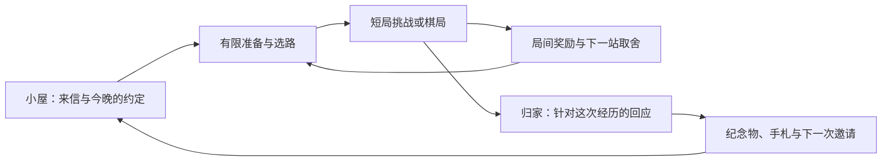

# 24 款独立游戏研究与下一版设计提案（v10）

日期：2026-10-20；确认记录更新：2026-10-22。状态：**资料与画面研究完成；独立星图棋旅、单程节奏、失败重试、少量法器／契约、横向成长，以及Q7精编短局先行／Q8双人约棋桌与有限恋爱样章已确认；实施进度见v12记录。**

本轮逐款读取开发者／发行商提供的官方商店资料，并由三名研究执行者各检查八款的公开截图。主执行者复看代表画面，并结合当前游戏桌面／手机截图做设计推导。这里的“研究”不等于完整实玩；静态图不能证明动画、声音、操作手感或完整循环。本报告没有验证当前畅销榜，也不宣称成品已经超过任何参考游戏。

## 1. 目标与现状

目标：让《巫师棋：与马尔福的甜蜜生活》同时拥有可反复研究的棋局、可信的共同生活，以及一套有辨识度的画面。把“更好玩、更好看”拆成能够验证的行为和成品要求，而不是继续增加功能数量。

已经确定并保留：成年返校同人设定、高清女性马尔福、全身魔镜、像素小屋、可动银河、默认像素 2D／可切 3D、预写对话、24 套衣装各 8 种真实表情。现有经典／魔法／好友棋局的规则与公平边界不因本报告自动改变。

当前源码与截图显示：

- 银河已存在，Three.js 有实时渲染路径；小屋已经有灯、炉火、植物、织物和双人棋桌。当前问题不能概括成“没有背景、没有家具”。
- 聊天页的小屋、高清魔镜、对白分别完整，但缺少共同承托和照明；对局里的棋盘、顶部信息、卡牌与魔镜也缺少空间联系。
- 封面标题、主要入口、收藏入口分散在不同边角；对局的重要信息没有全部靠近棋盘。手机竖屏已经密集，需要减少常驻区域，不能照桌面加面板。
- 有六章、情境对白、固定试炼、收藏、衣装番外、音乐／音效及保存机制。它们不能改名后当作新增玩法。
- 屋内真正的操作主要是角色聊天与棋桌入口；没有共同生活事件、物件位置与跨事件记忆构成的循环。

一轮隔离看图评审也指出三个问题：主体不在同一空间，素材精度缺少视觉解释，页面缺少整体骨架。结论来自当前四张图，不是交互或性能测试。

## 2. 24 款参考：事实与适配推导

每行的“学什么”是本项目的设计推导，不是参考游戏对本项目适配性的官方承诺。各款的机制、实际看图观察、来源和不宜照搬内容均有单独研究记录。

| 参考与官方资料                                                                             | 观察到的关键机制／画面组织                     | 本项目具体学什么                                               |
| ------------------------------------------------------------------------------------------ | ---------------------------------------------- | -------------------------------------------------------------- |
| [Balatro／小丑牌](https://store.steampowered.com/app/2379780/)                             | 协同构筑；目标、被动、手牌分处稳定区域         | 少量选择改变后续打法；展示触发因果；不把筹码倍率塞进将死规则   |
| [Slay the Spire／杀戮尖塔](https://store.steampowered.com/app/646570/)                     | 分岔路线、卡牌／遗物取舍；战场与手牌有固定位置 | 独立棋旅中的选路与奖励选择；避免将完整长棋局串成冗长旅程       |
| [Monster Train／怪物火车](https://store.steampowered.com/app/1102190/)                     | 三层车厢本身就是战场结构                       | 让桌面、卡槽、棋谱和镜座组成同一舞台                           |
| [Inscryption／邪恶冥刻](https://store.steampowered.com/app/1092790/)                       | 构筑、小屋秘密；手牌近景、棋桌中景、对手远景   | 桌边在场感、道具承担功能、可复察线索                           |
| [Dicey Dungeons／骰子地下城](https://store.steampowered.com/app/861540/)                   | 装备槽直接显示使用条件                         | 让技能的目标类型、限制和无效原因一眼可读                       |
| [Wildfrost／雪居之地](https://store.steampowered.com/app/1811990/)                         | 倒数与状态有固定角标；战斗连接据点成长         | 魔法剩余回合贴近棋子；完成事件后房间发生可见变化               |
| [Backpack Hero／背包英雄](https://store.steampowered.com/app/1970580/)                     | 有限空间里的物品组合；局外家园                 | 有限准备位置形成机会成本；纪念物陈列形成位置记忆               |
| [Luck be a Landlord／幸运房东](https://store.steampowered.com/app/1404850/)                | 小规则组合；中央操作区、周边协同物品           | 可解释的协同回顾；不把随机抽取当作全部乐趣                     |
| [Into the Breach／陷阵之志](https://store.steampowered.com/app/590380/)                    | 明确威胁与短任务；箭头落到相关格               | 施法后果预览、短局编排、明确失败解释；不泄漏未知手牌与未来棋步 |
| [Shotgun King](https://store.steampowered.com/app/1972440/)                                | 局间成对收益与代价；棋盘周边固定升级位         | 独立挑战的双向契约；不替换现有国际象棋胜负规则                 |
| [Pawnbarian](https://store.steampowered.com/app/1142080/)                                  | 小棋盘与有限手牌的战术谜题                     | 递进练习与危险区说明；成长来自掌握交互                         |
| [Wildermyth／漫野奇谭](https://store.steampowered.com/app/763890/)                         | 选择改变人物经历；纸艺材质贯穿画面             | 少数选择能在后文回指，房间留下纪念                             |
| [Hades／哈迪斯](https://store.steampowered.com/app/1145360/)                               | 重复挑战连接人物故事；丰富环境保留战斗可读区   | 成败都能推进相处，反应依据真实事件；视觉高光服务行动           |
| [Darkest Dungeon／暗黑地牢](https://store.steampowered.com/app/262060/)                    | 准备、冒险、休整；统一粗线与材质               | 对局后情绪收束；镜子、棋具、对白采用同一套边缘与受光逻辑       |
| [Baba Is You](https://store.steampowered.com/app/736260/)                                  | 少数规则交互产生发现；留白突出关键关系         | 用已有魔法设计“原来还能这样”的题目；不引入自由规则编辑器       |
| [Return of the Obra Dinn／奥伯拉丁的回归](https://store.steampowered.com/app/653530/)      | 物件、姿态与场景互证支持推理                   | 公平的房间线索与主动记笔记；不靠乱点发光物件猜答案             |
| [The Cosmic Wheel Sisterhood／宇宙之轮姐妹会](https://store.steampowered.com/app/1340480/) | 星间剖面屋、制牌与有后果的叙事选择             | 场景、人物、对白共同构图；选择能被后续提起                     |
| [Strange Horticulture／奇异园艺](https://store.steampowered.com/app/1574580/)              | 百科、放大镜、顾客与抽屉构成固定工具位         | 信件、棋谱、图鉴成为能拿起和收回的器物                         |
| [Coffee Talk／咖啡心语](https://store.steampowered.com/app/914800/)                        | 制作饮品承载对人的理解；人物与吧台相连         | 从言语判断偏好，亲手做事，再看到回应                           |
| [VA-11 Hall-A／赛博朋克酒保行动](https://store.steampowered.com/app/447530/)               | 调制行为承担选择；对话与操作并列               | 记住她说过的话，用行动表达理解；不只有回答按钮                 |
| [Spiritfarer／灵魂旅人](https://store.steampowered.com/app/972660/)                        | 生活劳动连接关系；共同暖光与前景层次           | 关心留下可见变化；人物与道具共用光照                           |
| [Stardew Valley／星露谷物语](https://store.steampowered.com/app/413150/)                   | 自选活动、社交、家园；信封直接提示新事件       | 让物件告诉玩家此刻能做什么；事件随进度推进                     |
| [Unpacking／开箱](https://store.steampowered.com/app/1135690/)                             | 物件摆放讲述人生；家具自然承接操作             | 少量可选择摆放的纪念物，能够挪动、回忆来源                     |
| [A Short Hike／短途旅行](https://store.steampowered.com/app/1055540/)                      | 自选探索与短发现；道路、高差引导注意           | 用屋内异常、纸条、窗边物件邀请探索；提供无损提示               |

### 代表画面拆解

对《小丑牌》和《邪恶冥刻》的已看图观察，转为八项可执行的决定：

| 可见要素                           | 为什么有效                         | 我们采用的决定                                                 |
| ---------------------------------- | ---------------------------------- | -------------------------------------------------------------- |
| 小丑牌目标在左，被动在上，手牌在下 | 功能位置稳定，组合变多仍能找回操作 | 对局信息靠棋盘上缘，技能在下缘；镜子旁只放人物相关内容         |
| 小丑牌桌布铺满背景但低于牌面反差   | 有纹理仍保留行动焦点               | 背景银河可以有层次，棋格、目标与文字背后降低干扰               |
| 小丑牌颜色区分筹码、倍率与行动     | 同一种强调长期表达同一种含义       | 棋格选择、合法目标、危险提示分别有稳定形状与颜色，不能都用金光 |
| 小丑牌空位仍有明确所属区           | 留白等待未来决策，不像布局漏空     | 只有本模式实际持有的准备物件才占桌边位置，空位不画假功能       |
| 邪恶冥刻的手牌、棋桌、对手有前后景 | 让人感到自己坐在现场               | 近景卡槽／桌沿，中景棋盘与镜座，远景银河；棋格本身保持清晰     |
| 邪恶冥刻桌上道具与牌共用光源       | 不同对象属于同一空间               | 暖光同时影响桌边、镜框和道具，避免人物海报与棋类网页拼接       |
| 邪恶冥刻对手处于桌子的另一端       | 人物是对局现场的一部分             | 高清马尔福由全身魔镜解释，镜座与棋桌建立尺度和方向关系         |
| 两者都让高亮集中在当下动作         | 复杂画面仍能读出重要变化           | 选择、施法、回应依次获得强调，背景与装饰不同时抢亮             |

这里只分析静态构图；没有以截图证明参考游戏的动画时长或音效质量。

## 3. 推荐的产品结构

推荐意图：**两人在银河中生活，以棋局创造共同经历。每次有不同的战术取舍，回家时也有值得记住的事。**

保留原有玩法作为稳定入口；用户已确认新增独立的星图棋旅，作为新游戏性的主轴。普通棋局不承担所有新系统。下面的具体节奏、构筑与保存细则仍是待确认提案：

### A. 构筑与重玩：星图棋旅（暂名）

- 参考小丑牌的协同、杀戮尖塔的选路与 Shotgun King 的双向取舍，设计**独立的新模式**。起点是少量精选局面，不是把五盘完整国际象棋接成长链。
- 节点分为短残局、主题魔法棋局、准备事件、较难的收尾局。玩家选路线之前能读到主题和收益；随机来自有限内容组合，先验证可解再扩展。
- 构筑先从已有魔法的起手准备、后续替换与有限战前方案入手。例如偏位移、偏地形、偏破咒；奖励允许跳过，避免每次都无脑拿更强的一项。
- 基础版仍是每回合可选施法一次再走棋。协同来自局面与跨回合安排；不会为了演出把多次施法悄悄塞进同一回合。
- 示例取舍：选择下一场的三张起手牌，更容易围绕自己的计划行动；代价是放弃该站的另一种准备机会。用户已确认采用现有魔法加少量棋旅专属法器／契约；具体条目与合法组合仍须验证，不能一开始就引入几十条被动。
- 新模式中的构筑只属于本次旅程。衣装、亲近程度与房间装饰不增强好友棋力；现有固定试炼的可比规则也不被改写。
- 用户已确认采用该模式；一程以 15–25 分钟、4–5 场精编短局穿插少量事件为设计目标，可中断保存。时长是待试玩验证的目标，不是已有实测成绩。第 5 节的三个挑战节点属于首段原型预算，不代替正式一程的范围。
- 每程有一次失败后的重试机会；再败结束这趟旅程，保留已获得的收藏与生活记忆。另有不重复领奖的练习重试，练习不推进正式旅程。
- 暂停、关闭页面后恢复不属于失败，不消耗重试；明确放弃则结束该程。节点奖励须按同一旅程、同一节点去重，不能借重试或练习反复领取。这些边界作为上述确认规则的实施解释，需在实现时验证。
- 用户已确认长期解锁新路线、准备方案与共同经历，不永久叠加棋力。法器／契约清单、奖励规模与节点组合仍待收敛，不能把候选制作预算当作已经确认的全量规格。

### B. 棋盘上的理解与操作

- 选中魔法时，清楚显示目标类型、立即效果、有效期，以及为何当前目标无效；预览必须来自真实规则计算。
- 在明确开启的辅助层里显示已知攻击与保护关系；不得泄漏对手未知手牌，也不把未知的 AI 未来棋步当作确定意图。
- 对局结束回看一次真实的关键行动：发生了什么、用了什么、改变了什么。不能只报一个分数或编造“精彩操作”。
- 精编练习按“学一种交互→尝试两种交互组合→自主解题”递进；与已有六章和固定试炼明确区分。

### C. 马尔福成为共同经历的参与者

- 开局由她提出一个可选的小约定；中途回应实际施法、选择或失误；结束时回指当晚发生的事。关系内容可以在胜负两条路径都有进展。
- 只保存少数有明确用途的经历，例如“记住了她的饮品偏好”“共同解开过那封信”；后续在合适情境调用，避免把无条件随机甜话当作记忆。
- 情绪使用已有真实表情帧，区分当下回应与长期亲近程度。新增动作素材要单独制作，不能把整张人物来回缩放当作精细角色动画。
- 这部分扩充的是事件条件、反应编排和后效，不把已存在的表情、点击回应与番外再次算成新功能。

### D. 小屋中的新活动

1. **来信与轻谜题**：一封信里的三条信息分别对应书页、窗边物件和棋谱；玩家据此做一个判断，得到一段回应或纪念物。提供分层提示，线索可复看，不以像素搜寻卡住主线。
2. **茶桌的小仪式**：从她的说法判断口味／温度，完成两三步操作；做错能重做，也有自然的回应。该行为影响本晚话题与后续回忆，不做一个藏着惩罚的好感测验。
3. **共同纪念物**：先有少量精修摆放位置，如茶桌、书架、照片墙；玩家选择留下什么、摆在哪里，并能回看缘由。它们不提供普通棋局加成。
4. **物件化的旧入口**：衣橱进入已有衣装，书架进入已有章节／番外，照片墙进入已有 CG，棋桌进入已有模式。它改善沉浸和找入口，属于重构，不冒充新增玩法。

这些活动逐个成为完整事件，不同时扩成农场、商店经营、全屋建造与开放世界。

## 4. 画面如何丰满

### 共同的视觉规则

- 银河是可动远景；房屋／棋桌是中景；局部桌沿、茶杯、信件形成近景。每一层有不同尺度与运动速度；文字和落子目标不随视差移动。
- 高清人物由魔镜容纳，镜外像素场景保持一致颗粒。镜框要与棋具共享边缘层级和受光，镜中全身从头顶到双脚完整可见，姓名对白留在镜外。
- 高对比集中在棋盘、脸部和正在操作的物件。银河亮带绕开主要阅读区；更多内容不等于更多发光、金边和粒子。
- 小屋已有足够细节，重点转为可交互分层：炉火、杯中蒸汽、窗帘和两人小动作分别响应；一次操作看见明确的结果。
- 继续复用现有星夜手书作标题与少量手写内容，正文和规则用清晰常规字体，坐标／数字有稳定对齐。避免每个按钮和数值都以展示字体争夺注意。
- 延续现有深夜底色、学院绿、暖纸与旧金属；不重新用三个色板替代已经确定的风格。
- 手机保持完整棋盘与常驻头像，完整魔镜、手札和活动按需展开；压紧重复的顶部信息。桌面要组织横向空间，手机要控制纵向占用。

### 三种构图候选（文字方向，未制作新画面）

| 方向                            | 生成依据与主视觉                                   | 骨架／主动作                                                                               | 字体、色彩与控件                                                                     |
| ------------------------------- | -------------------------------------------------- | ------------------------------------------------------------------------------------------ | ------------------------------------------------------------------------------------ |
| **A. 银河中的实体棋桌（推荐）** | 棋桌与镜座共同受光；近景的信、茶具、卡槽有实际用途 | 对局约三分之二宽度组织为棋桌，右侧完整魔镜；信息贴棋盘边，手牌收在卡槽。小屋保留为归家入口 | 沿用手书标题与清楚正文；夜色、学院绿、暖纸；棋具铜边分主次，按下有短而清楚的器物反馈 |
| **B. 可生活的小屋剧场**         | 像素剖面小屋成为主角，灯与物件提示可做之事         | 主厅占大半画面，点击一个物件后聚焦活动；交谈时高清魔镜与该活动共享前景。棋局仍进专注视图   | 同一字体与色板；标签依附屋内物件，仅关注时展开，减少常驻工具条                       |
| **C. 星图与共同手札**           | 纸页上的旅程、信件与真实纪念物成为章节工作区       | 中央展开星图／手札，边缘放当前构筑与收藏；右侧魔镜回应当前选择；小屋保留独立主场景         | 同一字体与色板；页签、书签和压纸物件表达层级，阅读与路线选择先于房间漫游             |

A 重视对局在场感，B 重视生活探索，C 重视旅程与回忆管理。它们是主工作区的不同优先级，并非三个新模式或一次都要制作的承诺。最终需要选择直接精修一个，或先做三张首屏比较。

## 5. 第一段应该做到多完整

推荐先验证一段可以反复玩的完整样章，再扩充数量。下面是**候选制作预算，不是已完成资产或已确认排期**：

| 层次 | 首段候选范围                               | 必须能观察到的结果                                       |
| ---- | ------------------------------------------ | -------------------------------------------------------- |
| 画面 | 一套统一棋桌＋魔镜，对应小屋入口与竖屏构图 | 不靠说明就能认出同一世界；不裁人物，不牺牲棋格与文字     |
| 战术 | 三个短挑战节点、两种路线选择、少量准备方案 | 相同节点换一种准备有不同决策；每个允许组合经过可解性检查 |
| 生活 | 一封邀请、一次茶桌互动、一条可选线索       | 玩家做过判断和操作；回应引用实际选择                     |
| 记忆 | 三件有来源的纪念物、少量后续回指           | 刷新和恢复存档后仍在；失败也有合理收束                   |
| 反馈 | 选择、施法、关键结果、归家四段节奏         | 能解释后果；可跳过／减弱动态；快速连续操作不会丢状态     |

样章场景例：她把一封夹着棋谱的邀请留在桌上。玩家从前次记下的偏好做一杯茶，再在稳妥与较难路线间选择。棋局中的一个真实事件引出赛后回应；回屋后，双方用过的杯子或解开的书签被放在选定位置。下次她能自然提起它。每个连接都需要实现，不能只是五个互不相关的弹窗。

后续扩容以样章表现为条件：更多经过验证的局面、准备组合、房间事件及不同回应。种子分享与挑战扩展在其后考虑；新增衣装数量不作为本轮优先增量。

## 6. 工程边界与风险

当前是 React 呈现、共享棋规模型、AI Worker、独立 Three.js 银河／棋盘与账号存档。研究方案优先复用这些层；暂无证据表明需要换框架、加后端服务或付费 API。

若选定实施，影响层预计为：

- UI／场景：TitleScreen、棋盘周边布局、MirrorCompanion、样式与独立分层资产；不以叠加大量覆盖样式长期维持新旧两套规则。
- 内容：新的有限旅程定义、生活事件与反应编排；从 App 的接线处分离新增职责，避免继续把所有系统塞进同一个组件。
- 规则：准备与节点目标先放在对局外；任何实际改变棋局行动的法器，必须进入共享规则、AI 与合法性检查，不能只在 UI 里偷偷改棋盘。
- 保存：现有 PlayerSave schema 2 尚无旅程、生活事件或物件摆放字段。新增状态必须有明确版本、校验、旧档迁移、导入导出、快照恢复与账号隔离；不得仅保存在临时界面或另开无备份的存储键。
- 联机与排行：本轮不默认扩展好友协议或改写固定试炼；构筑成长与普通对战公平性分开。

重点风险：组合导致无解、重复玩法时长过长、规则解释负担、情境台词与事实不符、小屏拥挤、动效争抢注意、保存部分成功和旧档丢字段。分别通过有限组合、精编局面、内容条件校验、设备实图和保存回归处理。

## 7. 质量目标与验证方法

以下是未来验收方法，**本轮没有执行这些新功能测试，也没有收集玩家结果**：

1. **画面与可用性**：桌面、横屏、竖屏检查标题层级、64 格辨识、全身镜和八种表情切换；确认没有遮挡、重复人物与滚动溢出。统一材料并不要求所有素材变成同一分辨率。
2. **决策质量**：同一原型至少存在几种有意义的准备／路线选择；记录玩家为何选它，以及是否愿意主动再试，不能用牌的数量代替重玩证据。
3. **学习与解释**：让未读文档的玩家说明一次施法为什么有效、哪里不能用、失败原因是什么。提示逐级提供，不能由说明文字代替清晰操作。
4. **共同生活**：玩家能复述一个由自己的行为导致的回应或屋内变化；纪念物确实能查到来源。
5. **节奏**：观察首个有意义选择前的时间、停滞点、退回次数和是否跳过茶桌／对白。短局时长用实际试玩测量后再承诺。
6. **可靠性**：引擎与 AI 回归、规则组合／种子重现、节点奖励幂等、刷新中断恢复、旧档迁移、离线／保存失败／账号切换。新模式采用后再确定完整测试矩阵。
7. **性能与舒适**：实测代表设备的输入响应、帧时间与内存；保留减少动态，避免低端设备用更多粒子填空间。不能把自动化软件渲染等同手机真机。
8. **独立试玩**：使用新手和熟手分别观察“学得会”和“有深度”；对照可玩版本判断改动是否改进。通过研究或一轮静态评审不能宣布达到畅销游戏水准。

## 8. 设计树与本轮待决定项

- 已确定：题材、角色、美术混合方式、银河与小屋、棋规基础、2D／3D、现有内容范围。
- Q1 已回答：采用独立“星图棋旅”作为新增游戏性的主轴；原有经典棋、魔法棋和好友对局保留。该术语已写入 GLOSSARY。
- Q3 已回答：一程目标 15–25 分钟，4–5 场精编短局穿插少量事件，可随时中断保存；实际时长以后用试玩检验。
- Q4 已回答：每程一次重试，再败结束旅程；保留已获得的收藏与生活记忆，另有不重复领奖的练习重试。重试与练习术语已区分。
- Q5 已回答：现有魔法＋少量棋旅专属法器／契约；原有模式的将死、王安全和每回合一次可选施法不变。
- Q6 已回答：解锁新内容与新选择，不永久叠加棋力。
- 2026-10-22 的新授权：可以研究新的国际象棋玩法；但具体变体尚未选择，不能将早期提案中的将死条件直接强加给所有新模式，也不能因此改写原有模式。
- 最新前沿见 [五领域评委方案](studio-jury-v12.md)：Q7已确认精编短局先行、协作变体纸面保留；Q8已确认双人约棋桌与有限恋爱样章，替代旧Q2未决的三构图比较。不重复征求已确认内容。
- 已确认边界下继续收敛：法器及契约清单、合法组合与节点难度、资产预算、共同行动与记忆的验收。

本报告不新增已接受 ADR；GLOSSARY 记录已确认的星图棋旅、棋旅重试、棋旅练习、棋旅法器与棋旅契约概念，未确认的细则继续保留在提案中。第 9 节保留原研究轮次的完成状态，当前工程／Toy 状态以 v12 方案的日期与证据为准。

## 9. 证据索引与完成状态

- 当前游戏实图：研究目录 `.local/design-v9/baseline/`，桌面 1440×1000、竖屏 390×844，各有封面、小屋、聊天、模式入口与对局。它们是现有版本，不能冒充 v10 新设计。
- 八款构筑游戏：`.local/design-v10/decks/research.md` 与 `sources.json`。
- 八款战术／推理游戏：`.local/design-v10/tactics/research.md` 与 `sources.json`。Hades 的被观察官方战斗图属于早期版本，未当作当前完整 UI 证明。
- 八款生活／叙事游戏：`.local/design-v10/life/research.md` 与 `sources.json`。有些已下载图片未查看，manifest 明确标记；只引用实际看过的图。
- 研究图片仅供分析，不进入游戏发布资源。官方资料链接见第 2 节；所有适配设计均由本项目推导。
- 分支：沿用当前 feat/wizard-chess，仓库尚无 HEAD 提交，已有大量待提交工作；本轮不整理、提交或覆盖这些工作。
- IMPLEMENTED：本研究报告、来源记录，以及已确认的星图棋旅术语。
- CHECKED：24 款名称去重、三组每组 8 款、正文 24 个唯一官方商店 App ID、每款有已查看截图记录且对应文件存在；通过新文档格式与空白检查。这些只是研究材料一致性检查。
- REVIEWED：另由战术研究执行者核对正文、来源索引、棋规与存档边界，未发现 IMPORTANT 事实或范围问题；没有代替另外两组逐页重新联网复核。
- NOT IMPLEMENTED：新棋旅、生活事件、纪念物、v10 新 UI 与资产。
- NOT TESTED：参考游戏的完整实玩、新方案可玩性／留存、v10 性能、真实 Toy 与跨设备云恢复。
- Docker／Hosted CI：本轮未运行；无运行代码变更，不把历史测试算作本轮结果。
- 本轮无运行代码、API、数据库、服务端协议或发布变更；没有重新执行游戏构建和测试，也未创建提交／PR。
