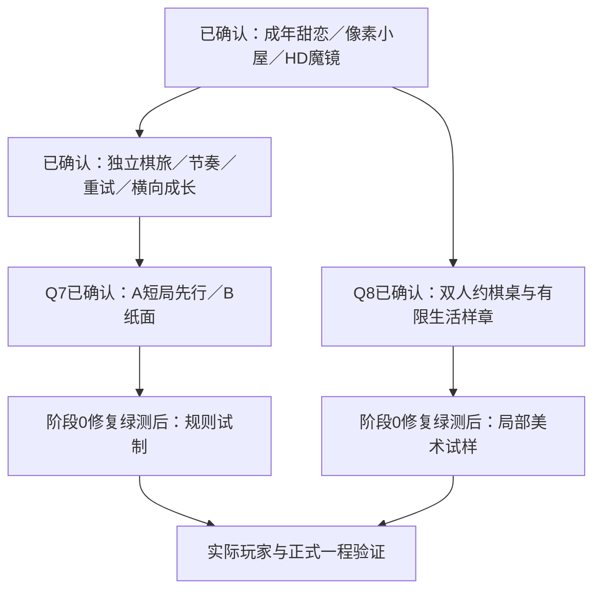

# 五领域评委方案：与她共度的星夜（v12）

日期：2026-10-22。状态：**五领域初审与交叉质询完成；Q7／Q8均已确认。阶段0与三节点有限样章已实现，当前验收与尚未完成门槛见[v12交付记录](delivery-report-v12.md)。**

本轮按用户要求先评审再实施。五方面评审均来自 AI 执行者的源码、实图与设计分析，不是真人试玩、独立媒体评价或市场结果。本文把用户已确认的边界、评委建议、分歧与未通过的工程门槛分别记录。

## 1. 当前判断

当前成品是一套有辨识度、内容资产较丰富的同人棋类原型，**还不能认定达到精美独立游戏的完整水准**。暖光像素小屋、可动银河、高清全身魔镜值得保留；主要差距是共同生活缺少实际行动，棋盘／魔镜缺少共同空间，短局与构筑还没有形成可验证的复玩循环。当前代码又有中断修复，不能用历史绿测代替现状。

另有待验证的动机风险：现有短章节可重新开局，极短目标也能触发独立对局奖励；玩家可能重复最短流程收集衣装，而非体验不同棋局与相处。这是源码推导，不是本轮实测的刷取漏洞或玩家行为结论；本轮不擅改旧奖励规则，新棋旅须用真实选择差异与共同经历证明重开价值。

下一阶段建议只证明一件事：**玩家和马尔福共同完成一晚；战术选择产生不同过程，相处准确记住这一晚。** 先做有限纵向样章，验证后再扩成正式一程。不承诺销量、成瘾性、奖项或超过参考作品；这些愿望需要实际作品与玩家证据支持。

## 2. 五领域意见与反对条件

各自先独立审查，再做跨领域质询；原始报告及后续意见保留在本机评审目录 `.local/jury-v12/`。美术、UI、玩法初审日期为10月21日，整体设计、玩家感受和工程冻结核查在10月22日完成。它们不是五名真实玩家的试用结果。

| 领域     | 独立判断／建议                                                                       | 必须保留的反对条件                                                                  |
| -------- | ------------------------------------------------------------------------------------ | ----------------------------------------------------------------------------------- |
| 美术     | 小屋负责双人行动，高清魔镜负责神态与衣装，银河负责远景；先做可读动作与共同受光。     | 单幅小屋上贴光、整屋摇晃、再添衣装不能证明两人共同生活。不得减少24×8真实表情。      |
| UI／交互 | 收敛为“银河里的双人约棋桌”：棋盘上缘放局势，下缘放行动，右侧完整魔镜共用桌沿与暖光。 | 常驻地图／遗物／收藏等新增侧栏会挤掉棋格与人物；竖屏不可继续按高度无限缩棋盘。      |
| 玩法     | 有条件推荐 A：保留将死的精编短局，作为首样章基础；B协作变体留作纸面反证。            | A若只是唯一解题库，没有构筑深度；B若只是车马拾取寻路，也不因原创而更好玩。          |
| 整体设计 | 暂以 A 做有限样章，证明同一节点不同准备有真实代价，并接上归家回指。                  | 不因复用引擎就放行A；出现固定最优路线或情话与行动无关时，先改设计，不扩题量。       |
| 玩家感受 | 支持有限A样章，失败也完整甜恋；首五分钟要有一次自主的有效行动与双向回应。            | 新手有提示仍卡将死时应重新评估A；手机只有小头像可能失去恋爱存在感，不能靠桌面代签。 |

原始报告：`art.md`、`ui.md`、`gameplay.md`、`direction.md`、`player.md`；美术、UI、玩法追加意见分别保存在`art-cross.md`、`ui-cross.md`、`gameplay-cross.md`。整体设计与玩家感受的交叉意见单列在各自报告末尾，原始独立意见保留。共同方向属于**有条件建议**，不是全票认定成品优秀；未回答意见不自动计为同意。

整体设计与玩家感受的交叉质询已补充三项约束：先有能玩的白盒，再决定完整动作帧数与环境循环；不要求本轮同时制作A／B两个可玩体；首个有意义行动目标不晚于90秒，教学与递茶的先后可以按实测调整。主厅母版尺寸、28帧动作、公开双方准备、单局动作上限均为候选工艺／规则，尚未由用户定案，实施时须先验证再冻结。

## 3. 已确认边界

- 成年返校 AU，成年女性马尔福与哈利的甜蜜恋爱是第一主题；不是胜利后才兑现的奖励。
- 像素小屋、可动银河、高清全身魔镜；桌面／横屏完整右栏，竖屏常驻头像并可展开；默认像素2D、保留3D切换。
- 保留24套成年衣装，每套8种真实表情、专属CG与番外；预写话题与回应。原稿保留。
- 独立星图棋旅为新增玩法主轴，经典／魔法／好友玩法保留。一程目标15–25分钟，4–5短局与事件交替，可中断保存。
- 每程一次重试，再败结束，保留已获得收藏与生活记忆；另有不推进、不重复领奖的练习。暂停／刷新不算失败。
- 用户已选择“现有魔法＋少量棋旅专属法器／契约”；长期只解锁新内容与新选择，不永久叠加棋力。旧规划 Q5／Q6 已补记为已回答。
- 用户允许研究新的国际象棋玩法；尚未确认某一个新变体。不能借此改写原有模式，亦不能声称用户已经选择6×6协作棋。
- Q8已确认：统一为“银河中的双人约棋桌”，棋盘和高清全身魔镜共用桌沿与暖光；有限样章验证邀请、短棋、一次递／接茶、准确回应与一件归家纪念物。保留24×8，新增总净增预算≤2MB，先白盒再制作必要动作，不扩房间。此确认不代替Q7的玩法顺序选择，也不把候选帧数或全部道具清单变成必做数量。
- Q7已确认：“同意Q7”。先按A制作三个精编将死短局样章；B保留纸面反例和必要时的对照原型。该顺序可被试玩证据推翻，不代表A已好玩，也不授权并行制作B引擎。

## 4. 推荐的可审阅样章

### 一晚的完整因果链

| 阶段 | 玩家实际做什么                                             | 她与画面必须产生什么结果                                           |
| ---- | ---------------------------------------------------------- | ------------------------------------------------------------------ |
| 邀请 | 读一封短邀请，选择今晚稳妥尝试或一起冒险；可直接自由约棋。 | 她回应这次约定，而不是通用欢迎词。                                 |
| 茶桌 | 两三步完成递茶／接茶；能调整选择，不做隐藏好感考试。       | 两个成年像素角色有明确动作；杯子状态改变；高清表情与当句含义一致。 |
| 短局 | 选择少量准备，完成一个真实战术取舍；可请求一次解释或演示。 | 不自动代走；回应只引用已确认事件，不虚构未来棋步或隐藏手牌。       |
| 局间 | 看懂刚才的收益／代价，选择下一站或准备；允许略过已读对白。 | 同一次选择改变下一节点的可观察过程，不只有更换卡面。               |
| 归家 | 胜利、失败或放弃都能继续完整相处；选择留下一件纪念物。     | 回指本次确实发生的约定／行动；下次能查到物件来历并被自然提起。     |

样章仅先试制**三个短局节点、一次茶桌事件、一条归家事件、一件纪念物及必要的后续回指**。这是试制预算，不冒充已确认的正式4–5场。测试用三节点的结果不能证明正式一程的15–25分钟成立。

先让白盒出现有效选择与准确回指，再用一段可辨的递／接茶验证美术；28帧动作、六件道具与四种环境循环均为额度上限，不是白盒前置或必须做齐的清单。首次自主有效行动目标≤90秒，分别记录首个生活选择与首个自主棋类判断，不能用点“继续”或递茶掩盖棋局卡住；可跳过的30–45秒演示或一步原因辅助不发挑战奖励、不推进节点，使用帮助不减少关系内容。若生活准备挤占首次行动，先合并邀请／准备／说明或将递茶放到首局后，不自动加快台词，也不强制沿用旧UI报告的地图准备时间顺序。

剧情失败分支要记录具体过程。例如“请求了哪次帮助”“保留了哪个准备”“选择何时回家”；不能每次都回同一句泛泛安慰。双方都能主动提议、调整与接话，不把她写成只会害羞或夸玩家的奖励机。棋局熟练度不决定能否阅读恋爱正篇；提示／练习不减少关系内容。

### A：先验证精编将死短局

- 使用现有8×8共享引擎与低子力局面；每回合一次可选施法后走棋，保持王安全与真实将死。
- 首批只取少量适配魔法；法器／契约先各不超过两项。它们仍须有明确机会成本，不能把新增条目数量当深度。
- 旅程内可公开本节点双方准备与效果；不展示尚未决定的敌方必走箭头。普通／好友隐藏信息保持既有边界。
- 候选节点以少于十次己方行动为编排约束；具体上限逐局写清并检验。动作预算是旅程节点规则，不改写普通棋局胜负。没有墙钟倒计时逼迫玩家读剧情或下棋。
- 同一节点至少有两种准备能产生不同、可说明代价的合理方案。必须覆盖有效防守，不能把低难度AI漏防当成多解证明。若本质是唯一解谜题，就如实定位，不宣传构筑深度。
- 第一局只教当前所需的棋子与目标；采用合法格、一步原因、按需分层提示与双人演示，避免长规则弹窗。具体局面、FEN、魔法池和解答尚未编排验证。

**A的停止条件**：重玩只剩背谱、准备选择无代价、一个组合跨局通吃、需要大量解释才能将死。出现这些情况先重做或比较B，不继续批量生产关卡。

### B：保留双人协作变体的推翻窗口

候选为6×6、哈利车／马尔福马、收集与会合、公开敌方意图，无将军／将死。它尚未形成闭合且验证过的规则；成功与敌方结算顺序、意图失效等待、交换是否拾取都需明确。

先纸面列三局、可行路线和强策略反例；重点检验“车取两片、马取一片”“冻结活动敌棋”“挡住意图让敌人等待”等是否成为通吃套路。不先制作第二套生产引擎或大批素材。若A持续让目标新手卡住，且B纸面规则已闭合、能反驳强套路并显示值得试验的收益，再提出B有限可玩原型。之后才能用同条件真人比较判断B是否更易懂、有取舍；不能把尚不存在的B试玩成绩设为制作B原型的前置条件。暂缓不等于永久否决，A失败也不等于B成功。

## 5. 画面与像素增量

统一方向建议：**银河中的双人约棋桌**。封面展示整体小屋；生活事件聚焦主厅；棋局使用桌沿／深绿桌垫连接棋盘和镜座。星图、棋盘、生活事件轮流占左侧主工作区，右侧人物保持连续身份。标题与主邀请用现有书写字体，正文与规则保持清楚字形。

银河保留真实运动与景深，亮带避开棋盘和文字。温馨来自手、杯、围巾、炉火和双方回应；前景道具要有用途。只在当前动作上集中强调，减少动态后信息完整。

| 像素内容       | 首批数量／用途                                                       | 运行资源预算上限 |
| -------------- | -------------------------------------------------------------------- | ---------------: |
| 主厅分层       | 一座小屋主厅，建筑后景／家具／人物后物件／前景遮挡／局部光；不扩房间 |        420,000 B |
| 成年双人动作   | 两人各待机4帧、转头4帧、递／接茶6帧；先一套日常衣着                  |        180,000 B |
| 环境短循环     | 炉火、茶汽、窗帘、来信四项，合计18帧                                 |        160,000 B |
| 事件道具       | 六件、各三状态；只有实际事件用到才制作                               |        120,000 B |
| 节点／法器符号 | 最多13个，不先画未定规则图标                                         |        100,000 B |
| 棋子与标记     | 六种×两色，共12个32px母版及共用状态标记                              |        100,000 B |
| 桌沿与镜座     | 一套共用前景与暖光，不重画高清人物                                   |        180,000 B |
| **美术预算**   | 帧和导出不重复算成独立内容                                           |  **1,260,000 B** |

为代码、元数据与偏差另留740,000 B；首段总净增目标不超过2,000,000 B。这是预算，**不是已生成文件或压缩实测**。先做一个主厅局部与递茶片段实看再展开。旧图人物需正确清除与分层，不能在原有坐姿上叠新人物造成重影；原稿另存保留。

上述表格是最大制作额度。只有杯组、来信、唯一纪念物等被样章实际使用的内容先生产；未使用的状态、循环与图标保留额度，不为凑数量制作。352px逻辑母版与48×64人物等尺寸仍待局部实看，不先锁成整套资产标准。

高清24×8表情继续承担镜中细节；不做24×8套像素复制。镜中完整头脚、最宽裙摆／帽饰／长发分别验收。像素动作与高清情绪分工清楚，不能用整屋或整张立绘缩放冒充角色动作。

完整魔镜常驻针对棋局、星图与普通相处界面；衣装番外的独立双人CG继续按既有单独展示，不能为“人物常驻”重新叠一层立绘。保留24页读完返回衣橱、选择与阅读位置保存的既有行为。桌面普通长文可占左侧工作区、镜子在右；竖屏按头像／完整魔镜／阅读状态分层，正文可滚动，棋局选目标时不得被阅读层遮住。

## 6. 从参考作品转成可验收工作

已有[24款机制与画面研究](indie-benchmark-and-design-v10.md)，另有Sea of Stars、Eastward、Potion Permit、Moonlighter四款的像素实图拆解。这些是官方资料与实际查看截图研究，未完整实玩全部作品，不代表市场预测。

| 借鉴方向                                           | 本项目落地判断                                                     |
| -------------------------------------------------- | ------------------------------------------------------------------ |
| Balatro：准备选择与协同                            | 同一节点换准备确实改变取舍；不直接照搬筹码倍率或靠更多被动填系统。 |
| Inscryption：桌边在场                              | 棋盘、镜座、卡槽共享承托和光源；每件桌上物件有用途。               |
| Into the Breach／Pawnbarian：紧凑战术与可解释后果  | 威胁、合法目标、限制在行动附近；新规则也要验证学习成本与支配策略。 |
| Coffee Talk／VA-11 Hall-A：通过行为理解人物        | 做一件具体的事，再看到她准确回应；不只连续选甜话按钮。             |
| Spiritfarer／Stardew Valley／Unpacking：物件讲经历 | 一件可查来源的纪念物留下共同记忆，不扩农场或经营系统。             |
| Cosmic Wheel Sisterhood与像素场景参考              | 场景、角色、对白共同构图；丰富外围层次，行动区保持清楚。           |

本轮再次核对的官方来源：[Balatro](https://store.steampowered.com/app/2379780/Balatro/)、[Pawnbarian](https://store.steampowered.com/app/1142080/Pawnbarian/)。上表右栏是本项目设计推导，不是参考作品对本方案效果的承诺。参考图仅供研究，不进入生产资源。

## 7. 架构、实施顺序与验证

现有架构：React／TypeScript呈现，独立共享棋规、AI Worker、2D／Three.js渲染器、Node权威好友房间、账号边界与快照保存。复用这些能力，不换框架、不新建付费服务。

| 阶段              | 影响层／可能文件                                                                                          | 放行条件                                                                                                                            |
| ----------------- | --------------------------------------------------------------------------------------------------------- | ----------------------------------------------------------------------------------------------------------------------------------- |
| 0：收尾既有修复   | `server/index.ts`、`src/App.tsx`、`src/platform/toy.ts`、`playerStorage.ts`、`SaveBoundary.tsx`、对应测试 | 异常升级地址不退出服务；本机／访客多标签旧进度不覆盖新进度；无锁降级有完整隔离和导出路径；类型、格式、单元、相关E2E及构建重新通过。 |
| 1：规则与美术试样 | 有限节点定义／共享规则适配；主厅局部、双人动作、棋子；对应UI容器                                          | A三节点有可核验方案和代价；B纸面反例完成；看得懂递茶和共同桌面；本阶段不扩正式内容量。                                              |
| 2：完整短样章     | 新旅程状态与事件模块、App接线、TitleScreen／MirrorCompanion／样式、saveModel迁移与快照                    | 真实入口完成邀请→行动→回应→归家；胜败、重试、练习、奖励幂等、中断、旧档迁移、离线和切号均覆盖。                                     |
| 3：玩家与平台验证 | 样章试玩、正式一程、实际Toy与App                                                                          | 小样本找到的问题已修；正式4–5场含阅读及一次重试的节奏实测；新包体测量与真实云／设备验证分项通过。                                   |

新玩法状态不能由UI直接另写几个存储键。当前PlayerSave schema 2没有棋旅／生活记忆／物件位置；实施前先定版本、校验、迁移、导入导出与快照恢复。跨异步事件要检查所属玩家和当前旅程。奖励按旅程／节点身份去重；重试、练习、重复点击、刷新不能重复领取。正常进度合并不能破坏玩家明确选择恢复较早阅读位置的语义。

阶段0的无锁降级采用页面私有临时会话：从验证过的local／guest原档复制初始值，所有游戏写入经同一个临时适配器隔离；原持久档不变。明确提供临时档与原件导出，并说明刷新／关闭前未导出的临时进度会丢失；不能仅让核心进度拒绝保存，却继续把设置／棋局／互动写回原档。账号云写入仍要求安全锁与可验证身份。此为恢复工程基线的技术方案，不新增永久存档承诺。

法器若改变合法行动，应进入共享规则、AI／预览与结算；新协作变体若获准，应独立建模，不把无王棋盘硬塞进普通王安全引擎。新对白按实际事件选取，不从UI动画完成推断棋步成功。现有好友协议、固定试炼成绩与竞技公平口径不扩展。

### 实际玩家与设备门槛（尚未执行）

- 先邀请8名目标玩家探索式试玩：4名棋类新手、4名熟手；不能当作留存统计或市场结论。记录每人原始时长、提示、停滞、误解、退出原因与是否主动再试，保留不利样本。
- 首五分钟至少一次自主有效行动、一次真实双向回应；不要求五分钟完成一程。玩家能复述一个战术取舍和一处由自己行为造成的回应。
- 若4名新手中至少2名仍需主持人教首次有效行动，先返工入口／提示；另记录每个人的误解，不用均值掩盖。手机在节点结束与归家主动呈现短双人回应，由玩家继续；选子／施法期间不自动展开长魔镜，不能只留一个新消息点承担恋爱主题。
- 将思考、系统等待、规则、剧情阅读分别计时；正式15–25分钟不能排除阅读、失败重试与慢玩家后才宣布达标。
- 如4名新手中至少3名在分层提示后仍不能解释或完成首个目标，暂停A扩容，重审教学／目标，并决定是否做B对照原型。此阈值只触发设计复查，不推断总体人群。
- 1440×900、1366×768、390×844、360×640、844×390实图和实际操作；竖屏优先完整可点棋盘与常驻头像，展开镜子可完整看头脚并回到原棋局。建议390宽内格约42px、360宽约38px；44px为主要按钮触控目标，不拿缩小棋盘硬塞短屏。
- 像素动作、HD表情、台词与真实状态同步；减少动态仍有完整反馈。真机帧时间／WebGL／Worker／音频与下载选择文件另测，软件渲染不代替手机。

## 8. 当前工程与Toy事实

### 执行前的中断记录（历史）

2026-10-21修复前：类型、格式、构建通过，单元121/121、隔离自动化Chromium E2E46/46。相同审查仍复现两个P1：异常WebSocket升级地址会退出服务；普通本机多标签旧状态可回写较低章节进度。基线绿测没有覆盖这两个问题。

随后修复中断。10月22日执行前对65个基线文件比较为59未变、6变化、0缺失；当时只读类型检查失败：App未定义`PROGRESS_KEY`，测试两处把异步下载路径强转为字符串；格式检查5文件失败。这些是执行前状态，**已由本次实现与重新验证替代**，不再代表当前源码检查失败。

原始核查保留在本机`.local/jury-v12/engineering-freeze.md`；修复后的六项定向E2E通过，最终完整结果见[交付记录](delivery-report-v12.md)。完整备份内容已从schema 2升级为schema 3，独立棋旅纳入迁移、导入导出与快照；一次棋旅命令原子提交一个JSON聚合。当前节点与B纸面材料见[规则试制](rules-paper-v12.md)。

### Toy发布门槛

| 层次           | 已有证据                                                                          | 当前限制                                                                                                     |
| -------------- | --------------------------------------------------------------------------------- | ------------------------------------------------------------------------------------------------------------ |
| CLI身份        | 10月22日`whoami --json`退出0，有有效身份；收据仅记布尔值，不保存身份详情。        | 未以create/update验证作品写权限，未上传、预览或提交审核。                                                    |
| 静态包         | 修复前ZIP 43,356,363 B，展开44,754,418 B、121文件；入口703 B。                    | 历史包与当前源码不同，不是本次修复后交付物。字体许可md副本也晚于该包。                                       |
| 路径／SDK      | 修复前`build:toy`与`verify:toy`通过，覆盖子路径、字体、Worker与SDK Mock存档恢复。 | Mock不等于真实Toy、云存档或B站App。                                                                          |
| 官方doctor     | 原始结果ERROR：CSS里的`%23n`被判成缺失`assets/#n`。                               | 手工检查它是data URI中SVG滤镜内部锚点；嵌套浏览器检查无该404。保留原始错误与误报判断，不能写成doctor全通过。 |
| 体积           | 按用户要求采用压缩／展开均低于50,000,000 B的保守门槛。                            | 送验目标均≤48,000,000 B，新增预算要重新构建实测；实际账号限额仍以发布页为准。                                |
| 好友服务       | 无公开WSS的Toy包明确显示好友模式未开放。                                          | 静态托管不能代替Node房间；外部域名审核与真实WSS未测试。                                                      |
| 真实运行／数据 | 保存边界已有历史Mock与隔离浏览器证据。                                            | 实际OpenID、云恢复、App杀后台、文件下载／选择、跨设备与真机性能仍NOT TESTED；不能保证个人数据永不丢失。      |

依据：[Toy官方内容清单](https://github.com/bilibili/toy/blob/main/skills/toy/references/content-checklist.md)。入口、相对路径、静态包、SDK与实际容器分别验收。只有真实验收完成后才讨论提交审核，本轮不发布。

## 9. 设计树与确认前沿

本轮两个独立取舍的回答状态：

1. **Q7已回答**：“同意Q7”。先按A做三个精编将死短局样章，B留作纸面反例和必要时的对照原型。这是可推翻的制作顺序，不是宣告A已好玩或永久取消新规则。
2. **Q8已回答**：“同意，按此有限样章推进”。以“银河中的双人约棋桌”统一空间，首批投入递茶／接茶、主厅分层、实际使用的可变道具、棋子与一条归家记忆，控制总净增≤2MB，暂不扩房间与大型新系统。

先前Q5／Q6与本次Q7／Q8已确认内容不重复征求。Q8替代旧Q2未决的三构图比较，视觉方向已收敛；按阶段0→试样→样章推进，具体节点与准备组合先离线核验，修复绿测后接入。玩法门槛失败时带证据重新打开对应分支。

## 10. 完成状态

以下为方案轮次冻结时的历史状态；**当前实施与验收以[v12交付记录](delivery-report-v12.md)为准**。新样章已接入，不能继续用本节旧的NOT IMPLEMENTED判断当前实现；实际玩家、正式一程、真实Toy门槛仍未完成。

- IMPLEMENTED：本方案、已确认Q5／Q6记录及法器／契约词汇、当前工程／Toy状态更正。
- REVIEWED：五领域源码／实图启发式意见及交叉质询；均有条件建议A有限样章先行、B纸面保留。条件与反例保留，不将评委意见冒充真人证据。
- NOT IMPLEMENTED：新棋旅、双人动作、生活事件、记忆、v12 UI与像素资源。旧中断补丁仍为WIP。
- TESTED：本轮只读类型／格式检查已执行且失败，具体如上；文档本地链接无缺失、24款参考App ID唯一、词汇无重名；新方案文档通过Prettier检查，文档空白检查通过。原始收据见`.local/jury-v12/plan-validation.json`。这些文档检查不等于产品测试。
- NOT TESTED：修复后运行回归、新方案可玩性、自发复玩、真人理解、真实Toy／App／跨设备；Docker与Hosted CI未运行。
- Git：沿用`feat/wizard-chess`，尚无HEAD／base SHA；大量intent-to-add和未跟踪内容均保留。本轮无提交、PR、合并、标签或发布；无新增API／数据库／依赖／服务协议变更。
- 安全影响：此方案轮次仅写文档与本机评审材料；CLI身份查询只保存成功布尔值，未将身份详情或凭据写入报告。运行层风险仍为中断补丁，未宣称已消除。

**五领域方案评审 READY：YES；Q7／Q8方案确认 READY：YES；新版实施／发布 READY：NO（实施中）。**
